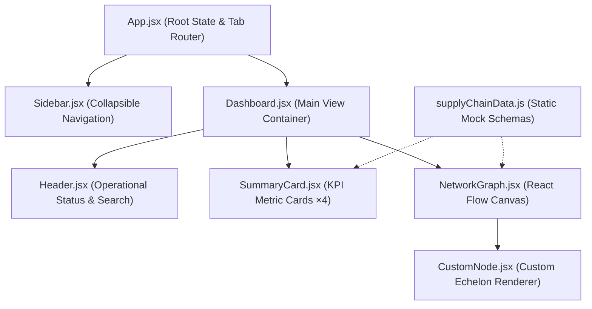
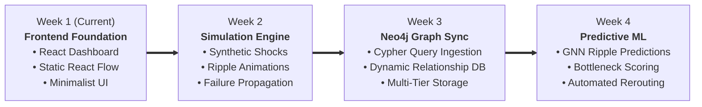

# AtmoGraph: Supply Chain Ripple Effect Predictor
## Week 1 Frontend Development — Technical Documentation & Presentation Deck

---

## Executive Presentation Deck

```
========================================================================================
                                     SLIDE 1
========================================================================================
```

# AtmoGraph
### Supply Chain Ripple Effect Predictor
**Milestone:** Week 1 Frontend Development  
**Role:** Frontend Developer / React Engineer  
**Tech Stack:** React 18 • Vite 6 • Tailwind CSS • React Flow (@xyflow/react) • Lucide React

> *"Visualizing multi-echelon supply networks to predict systemic disruptions before they propagate."*

---

```
========================================================================================
                                     SLIDE 2
========================================================================================
```

# The Challenge & Vision
### Why Supply Chain Ripple Effects Matter

- **The Problem:** Modern supply networks are fragile. A delay at a raw material mine or semiconductor fabricator cascades downstream, causing factory halts, inventory stockouts, and customer churn.
- **The Core Solution:** **AtmoGraph** provides an interactive topological graph mapping dependencies across every tier from raw extraction to end consumers.
- **Week 1 Objective:** Deliver a high-performance, minimalist, production-ready React dashboard with an interactive 6-node network flow and key operational metrics.

---

```
========================================================================================
                                     SLIDE 3
========================================================================================
```

# Architecture & Component Hierarchy



---

```
========================================================================================
                                     SLIDE 4
========================================================================================
```

# The 6 Echelons of Network Topology

AtmoGraph models the complete supply chain lifecycle through 6 synchronized echelons:

| Echelon # | Node Type | Facility / Entity | Location | Lead Time | Category Theme |
|:---:|:---|:---|:---|:---:|:---:|
| **1** | **Raw Material Supplier** | Apex Mining & Minerals | Perth, Australia | 21 Days | 🟢 Emerald |
| **2** | **Component Manufacturer** | Synapse Microtech | Hsinchu, Taiwan | 14 Days | 🔵 Sky Blue |
| **3** | **Assembly Factory** | Atmo MegaPlant | Austin, TX, USA | 7 Days | 🟣 Indigo |
| **4** | **Distribution Warehouse**| Central Logistics Hub | Chicago, IL, USA | 3 Days | 🟠 Amber |
| **5** | **Retail Store** | Metro Outlets | New York, NY, USA | 1 Day | 🔴 Rose |
| **6** | **Customer** | End Consumers | Global Target Market | Same Day | 🟣 Purple |

Directional flow: `Raw Materials ➔ Components ➔ Assembly ➔ Distribution ➔ Retail ➔ Customer`

---

```
========================================================================================
                                     SLIDE 5
========================================================================================
```

# Dashboard Key Performance Indicators (KPIs)

Four streamlined operational summary cards providing instant network intelligence:

```
+---------------------+ +---------------------+ +---------------------+ +---------------------+
| TOTAL SUPPLIERS     | | MANUFACTURING UNITS | | DISTRIBUTION        | | RETAIL LOCATIONS    |
| 24                  | | 8                   | | 12                  | | 185                 |
| 18 tier-1 · 6 tier-2| | 6 assembly · 2 comp | | 4 regional · 8 hubs | | Outlets & partners  |
+---------------------+ +---------------------+ +---------------------+ +---------------------+
```

- **Clean Typography:** Bold numeric metrics with subtle secondary subtitles.
- **Cognitive Clarity:** Eliminates visual noise, allowing operators to assess capacity at a glance.

---

```
========================================================================================
                                     SLIDE 6
========================================================================================
```

# Technical Implementation Highlights

- **React Flow (@xyflow/react v12):**
  - Smooth custom node rendering via React `memo`.
  - Directional connection arrows (`MarkerType.ArrowClosed`) on animated transit lines.
  - Interactive MiniMap with category-colored nodes.
  - Integrated Zoom, Pan, and Fit-to-Screen controls.
  - Interactive Node Inspector: Clicking any node surfaces an in-canvas telemetry card with lead times, throughput capacity, and transit modes.
- **Tailwind CSS Styling:**
  - Modern light theme (`bg-slate-50` canvas with crisp white cards).
  - Consistent spacing, Inter font typography, and custom scrollbars.
  - Fully responsive layout supporting desktop, tablet, and mobile drawers.

---

```
========================================================================================
                                     SLIDE 7
========================================================================================
```

# Performance & Quality Assurance

| Metric | Result | Status |
|:---|:---:|:---:|
| **Build Compilation (`vite build`)** | `0 errors`, `0 warnings` | ✅ Passed |
| **Transformed Modules** | `2,101 modules` | ✅ Optimized |
| **Production Bundle Size** | JS: `119 kB` (gzip) • CSS: `6.9 kB` (gzip) | ✅ Ultra-Light |
| **Dev Server Response** | HTTP `200 OK` on `http://localhost:3000` | ✅ Verified |
| **Git Version Control** | Initialized, clean tree, conventional commits | ✅ Ready |

---

```
========================================================================================
                                     SLIDE 8
========================================================================================
```

# Future Roadmap & Project Trajectory



---

<br/>

## Comprehensive Technical Documentation

### 1. Project Directory Structure

```
AtmoGraph/
├── index.html                   # HTML5 entry point with Inter font & meta tags
├── package.json                 # Dependency definitions & npm scripts
├── postcss.config.js            # PostCSS pipeline for Tailwind & Autoprefixer
├── tailwind.config.js           # Tailwind theme, brand palette & font config
├── vite.config.js               # Vite 6 configuration (port 3000)
├── README.md                    # Repository documentation
├── DOCUMENTATION.md             # Complete technical documentation & presentation deck
├── src/
│   ├── main.jsx                 # React DOM root render
│   ├── App.jsx                  # Main shell & tab state manager
│   ├── index.css                # Global CSS & React Flow overrides
│   ├── data/
│   │   └── supplyChainData.js   # Mock schemas: nodes, edges, KPIs
│   ├── pages/
│   │   └── Dashboard.jsx        # Primary dashboard container
│   └── components/
│       ├── CustomNode.jsx       # Custom React Flow echelon node
│       ├── Header.jsx           # Top bar: search, status, profile
│       ├── NetworkGraph.jsx     # Interactive canvas, minimap, inspector
│       ├── RiskOverview.jsx     # Vulnerability matrix view
│       ├── SettingsView.jsx     # Telemetry & canvas configuration
│       ├── Sidebar.jsx          # Left navigation sidebar
│       ├── SummaryCard.jsx      # Reusable KPI metric card
│       └── SuppliersView.jsx    # Facility & supplier directory view
```

---

### 2. Component Specifications & APIs

#### `CustomNode.jsx`
- **Purpose:** Renders individual echelon facilities within the React Flow canvas.
- **Props Accepted:**
  - `data.category`: Category identifier (`'raw_material'`, `'component'`, `'assembly'`, `'distribution'`, `'retail'`, `'customer'`).
  - `data.nodeType`: Human-readable echelon stage (e.g. "Component Manufacturer").
  - `data.name`: Entity title (e.g. "Synapse Microtech").
  - `data.location`: Facility geographical location.
  - `data.leadTime`: Operational delivery lead time.
  - `data.status`: Status indicator (`'Active'`).
  - `selected`: Boolean indicating if the node is currently clicked/highlighted.
- **Key Features:** Color-accented header bar, connection handles (`Position.Left`, `Position.Right`), icon mapping.

#### `NetworkGraph.jsx`
- **Purpose:** Central network visualization canvas wrapping `@xyflow/react`.
- **Key Features:**
  - `nodes`, `edges`: State managed via `useNodesState` and `useEdgesState`.
  - `onNodeClick`: Captures clicked node and displays the detailed overlay card.
  - `MiniMap`: Interactive bottom-right preview colored by node category.
  - `Controls`: Bottom-left interactive zoom and fit buttons.
  - `Background`: Subtle dot grid (`BackgroundVariant.Dots`).

#### `SummaryCard.jsx`
- **Purpose:** Modular KPI card for high-level statistics.
- **Props Accepted:**
  - `title` (string): Metric heading (e.g. "Total Suppliers").
  - `value` (string): Metric primary value (e.g. "24").
  - `subtext` (string): Secondary contextual detail (e.g. "18 tier-1 · 6 tier-2").
  - `iconName` (string): Key corresponding to Lucide icon component.

---

### 3. Data Models (`supplyChainData.js`)

#### Node Schema
```javascript
{
  id: 'node-2',
  type: 'supplyChainNode',
  position: { x: 340, y: 160 },
  data: {
    category: 'component',
    nodeType: 'Component Manufacturer',
    name: 'Synapse Microtech',
    location: 'Hsinchu, Taiwan',
    tier: 'Tier 1',
    status: 'Active',
    leadTime: '14 days',
    capacity: '88%',
    riskFactor: 'Moderate',
    transitMethod: 'Air Cargo',
    keyOutput: 'Semiconductors & PCBs',
  }
}
```

#### Edge Schema
```javascript
{
  id: 'e1-2',
  source: 'node-1',
  target: 'node-2',
  animated: true,
  style: { stroke: '#94a3b8', strokeWidth: 2 },
  markerEnd: {
    type: MarkerType.ArrowClosed,
    width: 16,
    height: 16,
    color: '#64748b',
  }
}
```

---

### 4. Running and Testing

```bash
# 1. Install dependencies
npm install

# 2. Start local development server
npm run dev
# Accessible at http://localhost:3000

# 3. Compile production build
npm run build
# Generates production distribution in dist/

# 4. Preview compiled build
npm run preview
```

---

### 5. Git Commit Log

- `feat(dashboard): setup AtmoGraph Week 1 frontend with React Flow supply chain graph`
- `refactor(ui): remove development milestone metadata and polish enterprise dashboard`
- `refactor: simplify dashboard and network graph design`
